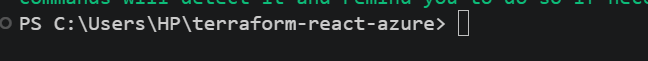
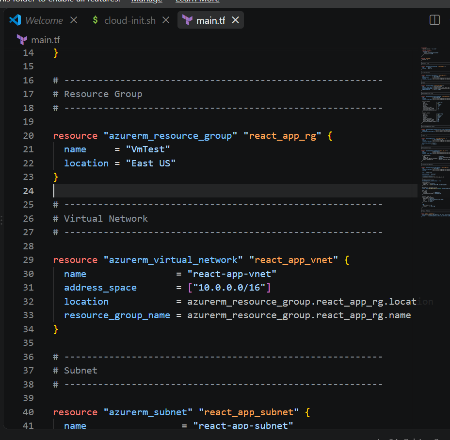
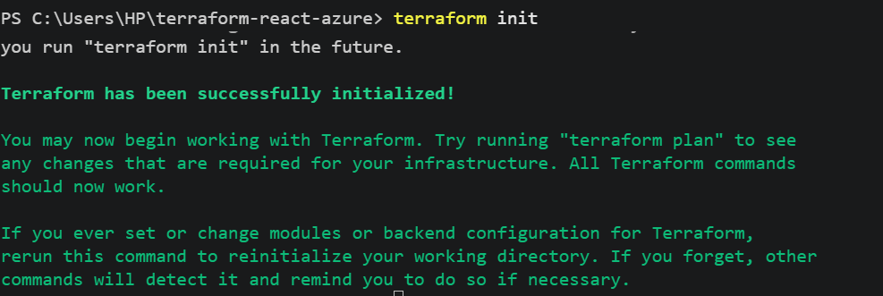
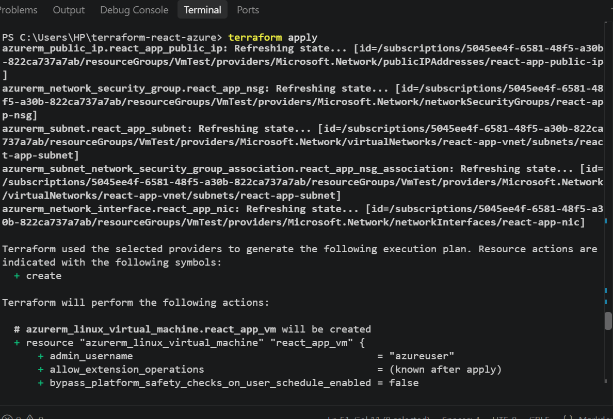
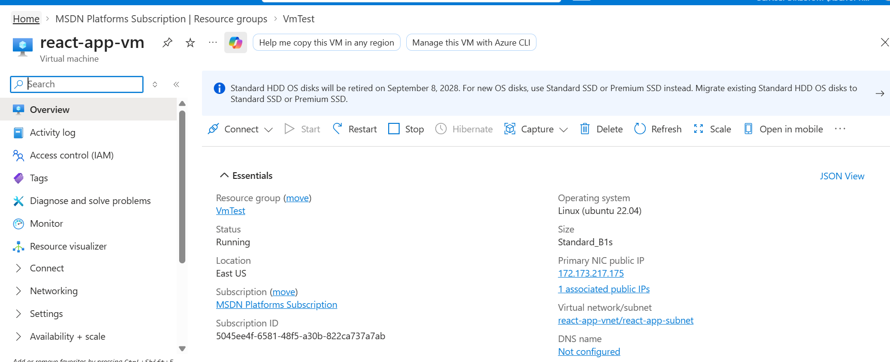
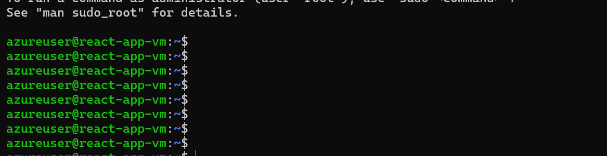
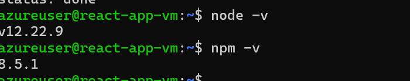
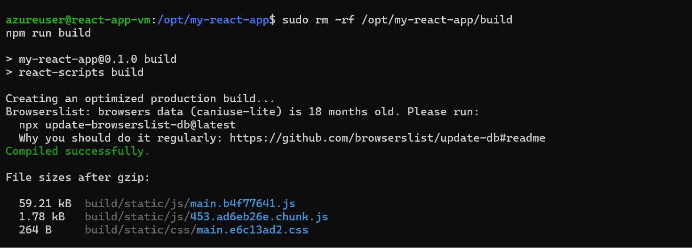
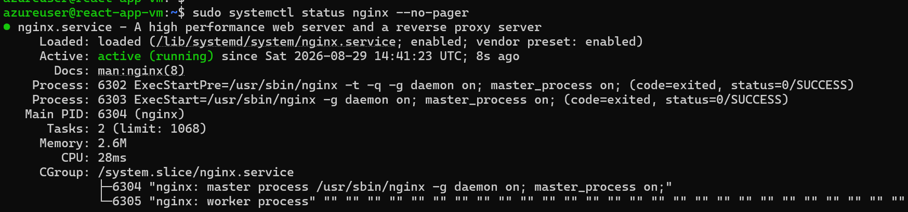
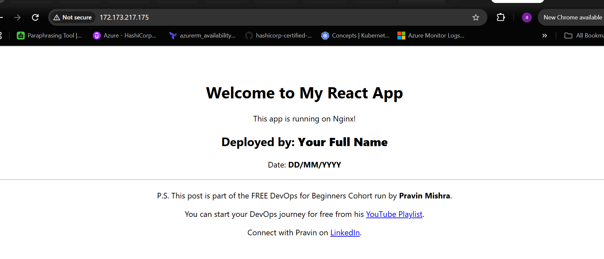

# Assignment 3 — Deploy a React Application on Azure Virtual Machine Using Terraform

Part of the DevOps Micro Internship (DMI) Cohort 3 with Agentic AI

---

## Purpose

In this assignment, you will use Terraform to provision an Azure resource group, network, and Ubuntu 20.04 VM, then deploy the `my-react-app` React application onto the VM over SSH and serve it through Nginx.

---

# Task 1 — Create a New Terraform Project

## Goal

Create a `terraform-react-azure` project directory for the Azure Terraform configuration.

### Evidence

#### Screenshot 1 — File Explorer, VS Code, or terminal showing the `terraform-react-azure` project directory



---

# Task 2 — Write main.tf to Provision the Azure Infrastructure

## Goal

Define the resource group, virtual network/subnet, Network Security Group (SSH 22, HTTP 80), public IP, network interface, and Ubuntu 20.04 Standard B1s VM in `main.tf`.

### Evidence

#### Screenshot 2 — VS Code showing `main.tf` with the required Azure resources, with any password or sensitive values hidden



---

# Task 3 — Initialize Terraform

## Goal

Run `terraform init` and confirm the working directory initializes successfully.

### Evidence

#### Screenshot 3 — Terminal showing successful `terraform init` output



---

# Task 4 — Plan and Apply the Configuration

## Goal

Review `terraform plan`, run `terraform apply`, and record the VM's public IP.

### Evidence

#### Screenshot 4 — Terraform apply output showing successful completion



---

#### Screenshot 5 — Azure portal showing the Virtual Machine running and its public IP



---

# Task 5 — Connect to the Virtual Machine

## Goal

Establish an SSH session with the Ubuntu VM through its public IP.

### Evidence

#### Screenshot 6 — Terminal showing a successful SSH connection to the Azure VM

<<<<<<< HEAD

=======
Add a screenshot of SSH terminal showing successful connection to the Azure VM and evidence that the React application deployment completed such as the deployed files in `/var/www/html` or successful cloud-init output.

Add your screenshot here.
>>>>>>> upstream/main

---

# Task 6 — Install Node.js, npm, and Git

## Goal

Update Ubuntu and install Node.js, npm, and Git.

### Evidence

#### Screenshot 7 — Terminal showing successful installation and the `node -v` and `npm -v` output



---

# Task 7 — Clone, Build, and Serve the React App with Nginx

## Goal

Follow the `my-react-app` repository README to clone, install, and build the app, then serve the production build through Nginx.

### Evidence

#### Screenshot 8 — Terminal showing the successful React build



---

#### Screenshot 9 — Terminal showing that Nginx is active and running



---

# Task 8 — Test the Deployment

## Goal

Confirm the React application loads through the VM's public IP and navigation works.

### Evidence

#### Screenshot 10 — Browser showing the React application with the Azure VM public IP visible in the address bar



---

### Notes

Write a short summary of what you built and any issues you encountered and how you resolved them.

I built and deployed a React application on an Azure Linux virtual machine using Terraform. The infrastructure included a resource group, virtual network, subnet, NSG with SSH and HTTP access, public IP, network interface, and Ubuntu VM. I automated the application deployment using a cloud-init script and configured Nginx to serve the React production build. During deployment, I encountered SSH key configuration and file-permission issues, including an incorrect SSH public key path and an EACCES error when rebuilding the application. I resolved these by correcting the SSH configuration and removing the existing build directory with appropriate privileges before running the React build again. The application then compiled successfully, cloud-init completed, and Nginx was running successfully.

---

# Task 7 — Share Your Deployment Progress on LinkedIn

## Goal

Share your React application deployment progress and DMI Leaderboard link on LinkedIn.

## Steps

1. Open the DMI Leaderboard and find your name.
2. Select **Share your progress**.
3. Select the **LinkedIn** option.
4. Use the generated message containing your leaderboard rank and personal progress link.
5. Attach **Screenshot 14** showing your React application running in the browser.
6. Add this caption:

```text
Just deployed a React application on an Azure Virtual Machine using Terraform! ☁️

I provisioned the Azure infrastructure with Terraform and automated the React application deployment using cloud-init Custom Data and Nginx.

Check my DMI learning progress below. 🚀
```

7. Publish the post on LinkedIn.

## Evidence

### Screenshot 16 — LinkedIn Post

Add a screenshot of your published LinkedIn post showing:

- The React application deployment screenshot
- The generated DMI Leaderboard message
- Your personal DMI progress link

Ensure that no passwords, private keys, account IDs, access tokens, or other sensitive information are visible.

Add your screenshot here.

---

# Submission Instructions

<<<<<<< HEAD
- Add all required screenshots in your submission
- Include the Azure VM public IP
- Do not expose Azure credentials, passwords, or private keys
=======
- Complete Tasks 0–7 in sequence.
- Include all 16 required screenshots exactly as specified.
- Ensure that your full name is visible in the required screenshots.
- Record the VM public IP address under Task 3.
- Ensure that the submitted evidence clearly matches the required task outputs.
- Include `main.tf` and `cloud-init.sh` in your GitHub submission.
- Do not expose passwords, SSH private keys, account IDs, access tokens, Azure credentials, or other sensitive information.
- Do not store secrets inside `cloud-init.sh`.
- Review all screenshots and project files carefully before submitting through GitHub.
>>>>>>> upstream/main

---

# Completion Checklist

<<<<<<< HEAD
- [ ] Task 1: `terraform-react-azure` project created (Screenshot 1)
- [ ] Task 2: `main.tf` defines all required Azure resources (Screenshot 2)
- [ ] Task 3: `terraform init` completed successfully (Screenshot 3)
- [ ] Task 4: Plan applied and VM running with public IP (Screenshots 4–5)
- [ ] Task 5: SSH connection verified (Screenshot 6)
- [ ] Task 6: Node.js, npm, and Git installed (Screenshot 7)
- [ ] Task 7: React app built and served through Nginx (Screenshots 8–9)
- [ ] Task 8: App verified through the VM public IP (Screenshot 10)
- [ ] Summary paragraph written (Notes)
- [ ] No sensitive information exposed
=======
- [ ] Installed Terraform and verified it using `terraform version`
- [ ] Installed Azure CLI and verified it using `az version`
- [ ] Signed in to Azure and confirmed the correct subscription
- [ ] Installed and enabled the HashiCorp Terraform extension in VS Code
- [ ] Created the `terraform-react-azure` project
- [ ] Created `main.tf`
- [ ] Defined the Terraform and AzureRM provider configuration
- [ ] Defined the resource group
- [ ] Defined the virtual network and subnet
- [ ] Defined the Network Security Group
- [ ] Configured SSH and HTTP rules
- [ ] Defined the public IP and network interface
- [ ] Created `cloud-init.sh`
- [ ] Reviewed the React application repository instructions
- [ ] Created the complete deployment workflow inside `cloud-init.sh`
- [ ] Defined the Linux virtual machine
- [ ] Connected `cloud-init.sh` to the VM using `custom_data`
- [ ] Used `file()` and `base64encode()` correctly
- [ ] Added the Terraform public IP output
- [ ] Completed `terraform init` successfully
- [ ] Reviewed the Terraform execution plan
- [ ] Completed `terraform apply` successfully
- [ ] Recorded the VM public IP
- [ ] Connected to the VM through SSH
- [ ] Verified that the automated deployment completed successfully
- [ ] Verified that Nginx is running
- [ ] Verified the React application through the browser
- [ ] Completed `terraform destroy` successfully
- [ ] Shared the React application deployment progress on LinkedIn by following Task 7
- [ ] Captured all 16 required screenshots
- [ ] Confirmed that my full name is visible in the required screenshots
- [ ] Checked that no passwords, keys, account IDs, access tokens, or other sensitive information are exposed
>>>>>>> upstream/main

---

## 📌 About DMI & CloudAdvisory

DevOps Micro Internship (DMI) is a project-based DevOps program run by Pravin Mishra (The CloudAdvisory) focused on real-world execution, systems thinking, and career readiness.

It helps learners build strong DevOps foundations with hands-on experience.

---

## 📌 Resources

- 🌐 DMI Official Website: https://dmi.pravinmishra.com?utm_source=github&utm_medium=readme  
- 🎓 University: https://university.pravinmishra.com?utm_source=github&utm_medium=readme  
- 💬 Discord Community: https://discord.pravinmishra.com?utm_source=github&utm_medium=readme  
- 📝 Blog: https://dmi.pravinmishra.com/blog?utm_source=github&utm_medium=readme  
- ▶️ YouTube Playlist: https://www.youtube.com/playlist?list=PLFeSNDtI4Cho  
- 🔗 Pravin Mishra (LinkedIn): https://www.linkedin.com/in/pravin-mishra-aws-trainer/  
- 🏢 CloudAdvisory (LinkedIn): https://www.linkedin.com/company/thecloudadvisory/

---

*This submission is part of DevOps Micro Internship (DMI) Cohort 3 — Agentic AI Track.*
